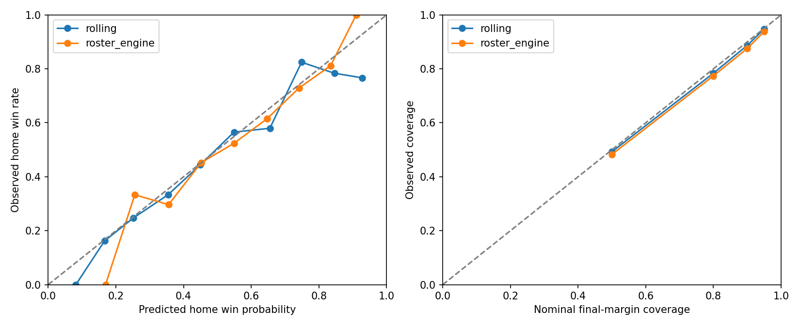

# Game-Log Calibration for V1 Single-Game Simulation

Research only. No production API/UI, playoffs, gamecast, season simulator, or team-model retraining.

## Reproduction and Provenance

`python scripts/simulation/acquire_game_logs.py` downloads only Games.csv, TeamStatistics.csv and TeamStatisticsExtended.csv. `--offline` verifies cached hashes without network. `python scripts/simulation/build_game_logs.py` rebuilds canonical games offline. `python scripts/simulation/game_log_calibration.py --develop` fits TRAIN and selects on validation; tests then `--final` once. `--report` only renders saved results. The exclusive ledger blocks further final evaluation or development.

Source: [https://www.kaggle.com/datasets/eoinamoore/historical-nba-data-and-player-box-scores](https://www.kaggle.com/datasets/eoinamoore/historical-nba-data-and-player-box-scores/versions/515), Eoin A Moore, NBA.com upstream per author. Version 515; CC0: Public Domain; updated 2026-06-15T11:08:10.51Z. Anonymous public Kaggle file endpoints, no token/login, HTML scraping, or restriction bypass. Cold pipeline requests: 4; warm/offline:0. Exact URLs/bytes/SHA256 in `data/simulation/game_log_source_manifest.json`. Raw downloads and large canonical/prediction CSVs ignored.

Coverage: 1979-80 through 2024-25, 51609 canonical regular-season games. Quarantined invalid records: 4; nonmatching canonical team-season schedule counts: 15. 2025-26 excluded prospectively because the pinned June snapshot is not assumed complete. Cup games count only when the official ID is002; finals/exhibitions/playoffs excluded. Full per-season counts and missingness in `game_log_quality.json`.

## Canonical Schema and Identity

`game_id, season, season_end_year, date, season_type, source_version, neutral_site, neutral_provenance, home_team_id, home_franchise_id, home_source_team_id, home_points, home_regulation_points, home_minutes, home_possessions, home_possession_method, away_team_id, away_franchise_id, away_source_team_id, away_points, away_regulation_points, away_minutes, away_possessions, away_possession_method, overtime_periods, overtime, possessions, pace, margin, home_win, regulation_margin, regulation_total, eligible, split, home_game_ortg, away_game_ortg, league_ortg, league_pace, league_prior_season_end_year, home_ortg, home_drtg, home_pace, home_prior_games, home_last_information_date, away_ortg, away_drtg, away_pace, away_prior_games, away_last_information_date`

Game IDs are source NBA IDs padded to10 digits, not synthesized IDs. Team/franchise IDs use the EXISTING historical identity functions, including separate Charlotte lineages, Nets, Seattle/OKC, Kings, Clippers and displaced Hornets. Game-index home/away IDs define joins; inconsistent box-row home flags are not trusted. Scores checked against corresponding team boxes; duplicate keys fail.

Actual possessions: mean of reported team possessions where present; else mean(FGA+0.44*FTA-ORB+TO). These fallback values are ESTIMATES, not reconstructed official counts. Source method is retained per side. Pace=possessions*48/game_minutes. Game minutes=numMinutes/5. Regulation points=sum(Q1..Q4), or final score only for confirmed48-minute games. Unknown/invalid periods remain missing/ineligible. OT possessions allocated by elapsed time, an explicit approximation. Outcome game ORtg columns are NEVER features; pregame home/away ORtg/DRtg/pace are separate fields. Missingness can restrict eligibility rather than fabricate historical fields.

## Leakage and Time Splits

`{"train": "1982-83 through2013-14 usable pregame strengths; prior years are source/warmup only", "validation": "2014-15 through2018-19", "test": "2019-20 through2024-25"}`

Pregame strength is regulation points per100 estimated regulation possessions, and pace. Each date's games are predicted BEFORE any results on that date update the accumulators. Fixed20-game previous-season franchise prior; expansion teams use prior league context. League environment uses only prior dates and a500-team-game prior-season prior. Every latest-information date is strictly earlier than game date. No full target-season team ratings, realized game pace, outcome, postgame Elo, or future roster outcomes enter model features. Actual pace is a TRAIN label/denominator for efficiency calibration only, never substituted for predicted pace at inference.

Counts: `{"train": 35514, "validation": 6149, "oof": 32713}`. Six expanding OOF blocks estimate variance from genuine earlier-fit predictions, not fitted residuals. OOF warmup through1984-85. Point model refit on all TRAIN only. Calibration candidates fixed before the final game test. Previously recorded TEAM-model test is protected by hashes and not rerun; the new GAME test evaluates a different locked research layer.

| candidate | train_end | evaluate_start | evaluate_end | n | pace_residual_sd | home_efficiency_residual_sd | away_efficiency_residual_sd |
| --- | --- | --- | --- | --- | --- | --- | --- |
| A_formula | 1985 | 1986 | 1990 | 4944 | 5.65799 | 9.44466 | 9.32654 |
| A_formula | 1990 | 1991 | 1995 | 5533 | 5.35929 | 9.71961 | 9.81340 |
| A_formula | 1995 | 1996 | 2000 | 5477 | 4.82991 | 10.43007 | 10.46208 |
| A_formula | 2000 | 2001 | 2005 | 5933 | 4.27818 | 10.44874 | 10.46389 |
| A_formula | 2005 | 2006 | 2010 | 6149 | 4.41017 | 10.58411 | 10.60099 |
| A_formula | 2010 | 2011 | 2014 | 4677 | 4.21965 | 10.31497 | 10.58944 |
| B_ridge30 | 1985 | 1986 | 1990 | 4944 | 5.41402 | 9.44481 | 9.29964 |
| B_ridge30 | 1990 | 1991 | 1995 | 5533 | 5.07777 | 9.72543 | 9.75997 |
| B_ridge30 | 1995 | 1996 | 2000 | 5477 | 4.63073 | 10.41800 | 10.43226 |
| B_ridge30 | 2000 | 2001 | 2005 | 5933 | 4.07407 | 10.42315 | 10.44468 |
| B_ridge30 | 2005 | 2006 | 2010 | 6149 | 4.04532 | 10.57953 | 10.56745 |
| B_ridge30 | 2010 | 2011 | 2014 | 4677 | 4.00875 | 10.28684 | 10.56043 |

## Home-Court and Variance Findings

TRAIN empirical blocks (final-score SD; adjusted effects use observed regulation pace for descriptive residual analysis, not prediction; effects are associations, not causal travel/home isolation):

| block | start | end | n | home_margin | home_win_rate | home_offensive_effect | home_defensive_effect | team_score_sd | total_sd | margin_sd | pace_sd | home_residual_sd | away_residual_sd |
| --- | --- | --- | --- | --- | --- | --- | --- | --- | --- | --- | --- | --- | --- |
| 0 | 1982-83 | 1988-89 | 6651 | 4.77086 | 0.65915 | 2.93633 | 1.85651 | 12.49117 | 21.03909 | 12.59985 | 7.32536 | 9.61353 | 9.79633 |
| 1 | 1989-90 | 1998-99 | 10915 | 3.74915 | 0.61438 | 2.15934 | 1.62446 | 13.11904 | 22.34078 | 13.24012 | 7.04715 | 9.58892 | 9.64388 |
| 2 | 1999-00 | 2008-09 | 12042 | 3.34969 | 0.60513 | 2.38833 | 0.97264 | 12.23354 | 20.59796 | 12.77362 | 5.21061 | 9.68412 | 9.72355 |
| 3 | 2009-10 | 2013-14 | 5906 | 2.91229 | 0.59583 | 1.76599 | 1.14971 | 11.92780 | 19.69502 | 13.14385 | 4.95594 | 9.69622 | 9.85319 |

Validation empirical blocks:

| block | start | end | n | home_margin | home_win_rate | home_offensive_effect | home_defensive_effect | team_score_sd | total_sd | margin_sd | pace_sd | home_residual_sd | away_residual_sd |
| --- | --- | --- | --- | --- | --- | --- | --- | --- | --- | --- | --- | --- | --- |
| 3 | 2014-15 | 2018-19 | 6149 | 2.61083 | 0.58367 | 2.00000 | 0.60173 | 12.64898 | 21.09635 | 13.71732 | 5.15987 | 10.15233 | 10.42738 |

Home effect is learned as a signed half-effect for each side, by broad TRAIN era, not hardcoded+3. The2010+ coefficients are estimated through2013-14 ONLY; no later home effect is silently refit. Era covariance is shrunk toward pooled OOF covariance using500 pseudo-games. Unseen recent years reuse the latest TRAIN block; validation chooses pooled versus era variance, not individual test-season coefficients.

## Expected Score and Candidates

A: efficiency=league+own_offense_above_league+opponent_defense_above_league+TRAIN common offset+signed home effect. Pace=mean(team paces). B: ridge30 learns the two efficiency weights, common offset, four signed home effects and a pace-deviation slope. Both predict efficiency before multiplying by expected possessions/100; they do NOT blindly average ORtg and opponent DRtg. No nonlinear family justified: retain the small4-candidate mean/variance comparison.

| candidate | efficiency_intercept | own_offense | opponent_defense | home_minus_away_effect_per100_by_era | pace | era_blocks |
| --- | --- | --- | --- | --- | --- | --- |
| A_formula | 0.53805 | 1.00000 | 1.00000 | [4.600443093740983, 3.8521218195987648, 3.596925309342134, 3.088818087576278] | {"slope": 1.0, "intercept": 0.0} | ["through1989", "1990-1999", "2000-2009", "2010 onward; TRAIN fit through2014 only"] |
| B_ridge30 | 0.54691 | 0.84015 | 0.81725 | [4.585062970764068, 3.837317267171403, 3.5866875482834906, 3.0791798080995227] | {"slope": 1.9119037248238502, "intercept": -0.29955959021065387} | ["through1989", "1990-1999", "2000-2009", "2010 onward; TRAIN fit through2014 only"] |

| candidate | n | score_mae | margin_mae | total_mae | margin_bias | brier | log_loss | accuracy | ece | margin_coverage80 | margin_coverage95 |
| --- | --- | --- | --- | --- | --- | --- | --- | --- | --- | --- | --- |
| A_formula_pooled | 6149 | 8.96554 | 9.81527 | 14.77242 | 0.35248 | 0.21019 | 0.60778 | 0.66612 | 0.00693 | 0.79525 | 0.93430 |
| A_formula_era | 6149 | 8.96590 | 9.81529 | 14.77238 | 0.35231 | 0.21016 | 0.60768 | 0.66612 | 0.00567 | 0.80875 | 0.94162 |
| B_ridge30_pooled | 6149 | 8.88682 | 9.79752 | 14.54171 | 0.34131 | 0.21067 | 0.60897 | 0.66466 | 0.01724 | 0.78988 | 0.93316 |
| B_ridge30_era | 6149 | 8.88794 | 9.79756 | 14.54353 | 0.34104 | 0.21086 | 0.60948 | 0.66466 | 0.02220 | 0.80566 | 0.94210 |

Selected `A_formula_pooled`. Selection: lowest validation log loss among candidates within0.5 best margin MAE; prefer simpler within0.002 log loss and0.2 score MAE. All actual coefficients/variance arrays are in the summary and ignored artifact.

## Win Probability and Monte Carlo

Draw jointly Gaussian residuals for pace, home efficiency, away efficiency using genuine TRAIN-OOF covariance. This retains shared pace and score correlation; independent score noise is not assumed. Compute score as (mean_pace+pace_noise)*(mean_efficiency+efficiency_noise)/100 minus the covariance-product mean term. Round to nonnegative integer scores. Analytic margin variance includes the Gaussian product's second-order covariance. Analytic probability combines Gaussian regulation win mass, the fitted close-game tie atom and a Gaussian OT-margin approximation; analytic final means approximate expected overtime additions. Monte Carlo explicitly resolves ties; analytic and MC probabilities are evaluated separately, not fitted to test outcomes.

Default10000 draws: worst-case win-rate MC standard error0.5 percentage points. Practical minimum1000:1.58 points, not the default. Seed is explicit, local numpy Generator; game-test seed=20261015+NBA game ID. Same input/seed exactly reproducible. Counts benchmarked, not assumed:

| count | seconds_median | worst_case_win_probability_mc_se |
| --- | --- | --- |
| 1000 | 0.00134 | 0.01581 |
| 10000 | 0.00161 | 0.00500 |
| 50000 | 0.00559 | 0.00224 |

Tied rounded regulation scores get explicit five-minute overtime scoring increments. Joint paired OT residuals are bootstrapped from genuine TRAIN-OOF games with exactly one observed OT, centered before adding expected5/48 regulation scoring. TRAIN-OOF diagnostics showed Gaussian rounding underestimates regulation ties. One empirical Bernoulli parameter moves a fraction of1-3 point rounded margins onto a tie, approximately preserving total score; it is not uniform scoring noise or an extra strength adjustment. This simple endgame atom changes near-zero regulation margins slightly and is an explicit modeling approximation. Repeat OT until untied; after20 periods fail loudly, never silently return a tie or resolve with a coin flip. This is not a possession engine.

Selected TRAIN-only overtime fit: `{"fitting_games": 1649, "repeat_probability": 0.14337662337662338, "observed_game_ot_rate": 0.05884510744963776, "tie_calibration": {"extra_tie_probability": 0.17622517169298976, "gaussian_tie_rate": 0.028781176872156575, "observed_tie_rate": 0.05884510744963776, "fitting_rows": 32713, "definition": "One fitted Bernoulli tie atom for rounded1-3 point margins; TRAIN only"}}`

## Existing Engine and Uncertainty

Frozen existing ORtg/pace artifacts and approved DRtg(identity gamma1) were loaded for an inference-only2014-15 through2018-19 bridge. No defensive tuning. Results below are diagnostic, not fully prospective: retrospectively known full-season roster membership does not establish what a pregame roster would have been. Primary probability/variance results use strictly prior-date box-score strengths.

`{"n": 6149, "metrics": {"n": 6149, "score_mae": 9.42808636561802, "margin_mae": 10.079262971588047, "total_mae": 15.795235900896651, "margin_bias": 0.37123771975909586, "brier": 0.2188719248006509, "log_loss": 0.6276988277932154, "accuracy": 0.6477476012359733, "ece": 0.011645997883237405, "margin_coverage80": 0.7754106358757522, "margin_coverage95": 0.9273052528866482, "calibration_bins": [{"low": 0.1, "n": 29, "predicted": 0.17042466436118592, "actual": 0.10344827586206896}, {"low": 0.2, "n": 146, "predicted": 0.26156697036700144, "actual": 0.2876712328767123}, {"low": 0.3, "n": 482, "predicted": 0.358881960130369, "actual": 0.2883817427385892}, {"low": 0.4, "n": 955, "predicted": 0.45433718113945876, "actual": 0.44502617801047123}, {"low": 0.5, "n": 1480, "predicted": 0.5515067043131843, "actual": 0.5466216216216216}, {"low": 0.6, "n": 1541, "predicted": 0.6494903853492449, "actual": 0.6463335496430889}, {"low": 0.7, "n": 1093, "predicted": 0.7462870829340257, "actual": 0.7520585544373285}, {"low": 0.8, "n": 383, "predicted": 0.8377001982206902, "actual": 0.8276762402088773}, {"low": 0.9, "n": 40, "predicted": 0.9185647535445074, "actual": 0.9}]}, "identity_gamma": 1.0, "team_model_retrained": false, "prospective": false, "warning": "Retrospective season membership; uncertainty/variance trained on different pregame-strength estimator; diagnostic only"}`

Keep point means unchanged. HIGH is an explicit unsupported-domain warning, not a calibrated probability interval. No arbitrary variance multiplier.

Statistical game-outcome intervals do not quantify unknown synthetic-roster interactions. Keep HIGH flags, warn and restrict claims; do not arbitrarily shift means or apply an unvalidated2x variance. Numerical epistemic propagation remains a targeted requirement for a prospective engine bridge, not hidden behind attractive winner accuracy.

## Limitations

- Game calibration primarily validated with prior-date box-score strength estimates, not timestamped player rotations
- Frozen team-engine bridge uses retrospectively known season membership; not a fully prospective roster test
- 2010-14 learned home effect and latest training-era covariance extrapolated to newer eras without refitting
- Only identified Orlando neutral games excluded; other neutral sites may remain
- Possession estimator changes around1996-97; early box scores have missingness
- 1979-80/1980-81 and much of1981-82 have zero-coded unavailable FGA; retained scores cannot supply valid possessions
- Pinned source has five missing2024-25 games plus four invalid tied/zero-score records quarantined across all years
- Gaussian latent residuals approximate tails; overtime bootstrap is not possession-by-possession

## Final Game Test and Decision

Thresholds fixed before test: score MAE<=11; margin MAE<=13.5; total MAE<=17.5; Brier<=.23; log loss<=.66; ECE<=.04; regulation-margin80% coverage in[.75,.85],95% coverage in[.92,.98]; each season absolute margin bias<=3 and ECE<=.07. A additionally requires a fully prospective existing-engine bridge. These are research criteria, not the old defensive gates.

| method | n | score_mae | margin_mae | total_mae | margin_bias | brier | log_loss | accuracy | ece | margin_coverage80 | margin_coverage95 |
| --- | --- | --- | --- | --- | --- | --- | --- | --- | --- | --- | --- |
| analytic | 6906 | 9.38052 | 10.98617 | 15.02747 | 1.16908 | 0.22184 | 0.63479 | 0.64263 | 0.03894 | 0.75630 | 0.91312 |
| MC10000 | 6906 | 9.37916 | 10.98864 | 15.02574 | 1.16605 | 0.22183 | 0.63477 | 0.64133 | 0.03688 | 0.75630 | 0.91312 |

| season | n | score_mae | margin_mae | total_mae | margin_bias | brier | log_loss | accuracy | ece | margin_coverage80 | margin_coverage95 |
| --- | --- | --- | --- | --- | --- | --- | --- | --- | --- | --- | --- |
| 2020 | 971 | 9.19240 | 10.24045 | 15.24531 | 0.72575 | 0.21631 | 0.62082 | 0.66941 | 0.04207 | 0.79506 | 0.93409 |
| 2021 | 1080 | 9.51092 | 11.48606 | 15.01921 | 2.12711 | 0.23524 | 0.66456 | 0.60185 | 0.06267 | 0.73981 | 0.91481 |
| 2022 | 1172 | 9.48963 | 11.56232 | 14.93610 | 1.34885 | 0.22266 | 0.63967 | 0.64164 | 0.04442 | 0.73208 | 0.89420 |
| 2023 | 1230 | 9.11609 | 10.25861 | 14.79879 | 0.54866 | 0.22774 | 0.64879 | 0.63496 | 0.03133 | 0.79350 | 0.92846 |
| 2024 | 1230 | 9.55298 | 11.12579 | 15.26302 | 0.85683 | 0.21457 | 0.61643 | 0.64715 | 0.04586 | 0.74309 | 0.90732 |
| 2025 | 1223 | 9.40267 | 11.17601 | 14.94245 | 1.44078 | 0.21496 | 0.61930 | 0.66149 | 0.04744 | 0.73917 | 0.90352 |

| group | n | score_mae | margin_mae | total_mae | margin_bias | brier | log_loss | accuracy | ece | margin_coverage80 | margin_coverage95 |
| --- | --- | --- | --- | --- | --- | --- | --- | --- | --- | --- | --- |
| even_abs_expected_margin_le3 | 2181 | 9.38492 | 11.13299 | 15.07138 | 1.43629 | 0.24938 | 0.69192 | 0.53599 | 0.04401 | 0.76341 | 0.91609 |
| home_underdogs | 2169 | 9.44777 | 10.99902 | 15.20069 | 0.45378 | 0.22483 | 0.64082 | 0.64454 | 0.02641 | 0.74919 | 0.91471 |
| strong_mismatch_abs_expected_margin_ge10 | 1148 | 9.28206 | 10.89410 | 14.97814 | 1.54803 | 0.15850 | 0.49982 | 0.80488 | 0.04811 | 0.74913 | 0.91028 |
| high_pace_ge100 | 2976 | 9.57947 | 11.11960 | 15.38448 | 1.10689 | 0.22143 | 0.63307 | 0.64046 | 0.03825 | 0.75638 | 0.91767 |

Elite/poor matchup proxy is abs(expected margin)>=10; it is not defined using final standings/outcomes.

| block | start | end | n | home_margin | home_win_rate | home_offensive_effect | home_defensive_effect | team_score_sd | total_sd | margin_sd | pace_sd | home_residual_sd | away_residual_sd |
| --- | --- | --- | --- | --- | --- | --- | --- | --- | --- | --- | --- | --- | --- |
| 3 | 2019-20 | 2024-25 | 6906 | 1.87127 | 0.55184 | 1.70005 | 0.19232 | 12.59474 | 20.08521 | 15.08768 | 4.62603 | 10.95967 | 11.01176 |

Observed test OT rate=0.04561; MC rate=0.05742. Entire test MC time=27.15s. No retuning.

| low | n | predicted | actual |
| --- | --- | --- | --- |
| 0.00000 | 15 | 0.07823 | 0.06667 |
| 0.10000 | 117 | 0.16253 | 0.20513 |
| 0.20000 | 384 | 0.25513 | 0.28385 |
| 0.30000 | 708 | 0.35251 | 0.34181 |
| 0.40000 | 945 | 0.45347 | 0.41799 |
| 0.50000 | 1313 | 0.55235 | 0.50495 |
| 0.60000 | 1387 | 0.64890 | 0.61644 |
| 0.70000 | 1120 | 0.74828 | 0.69732 |
| 0.80000 | 734 | 0.84335 | 0.79973 |
| 0.90000 | 183 | 0.92488 | 0.84153 |

Representative games chosen by predicted matchup context, not whether the prediction was correct:

| example | game_id | date | season | home_team_id | away_team_id | home_points | away_points | home_win_probability | analytic_probability | ot_rate | mean_home_points | mean_away_points | margin_interval80 | mean_possessions | count | seed | uncertainty | warning |
| --- | --- | --- | --- | --- | --- | --- | --- | --- | --- | --- | --- | --- | --- | --- | --- | --- | --- | --- |
| close | 0022100809 | 2022-02-06 | 2021-22 | team:los-angeles-clippers | team:milwaukee-bucks | 113 | 137 | 0.49970 | 0.49996 | 0.06260 | 110.66780 | 110.66450 | [-16.0, 16.0] | 99.83375 | 10000 | 42361824 | STANDARD | None |
| strong_favorite | 0022400400 | 2024-12-23 | 2024-25 | team:oklahoma-city-thunder | team:washington-wizards | 123 | 105 | 0.97970 | 0.97740 | 0.00940 | 126.10380 | 100.86700 | [9.0, 41.0] | 101.85942 | 10000 | 42661415 | STANDARD | None |
| high_scoring | 0022300480 | 2024-01-05 | 2023-24 | team:indiana-pacers | team:atlanta-hawks | 150 | 116 | 0.61960 | 0.61178 | 0.06210 | 128.89280 | 125.13330 | [-12.0, 20.0] | 102.48413 | 10000 | 42561495 | STANDARD | None |
| low_scoring | 0021900007 | 2019-10-23 | 2019-20 | team:miami-heat | team:memphis-grizzlies | 120 | 101 | 0.67290 | 0.67485 | 0.06430 | 105.95310 | 100.40020 | [-10.0, 21.0] | 97.97859 | 10000 | 42161022 | STANDARD | None |

Acceptance: `{"score_mae": true, "margin_mae": true, "total_mae": true, "brier": true, "log_loss": true, "calibration": true, "coverage80": true, "coverage95": false, "monte_carlo_metrics": false, "season_stability": true, "prospective_existing_engine_bridge": false}`

**B. GAME-LEVEL CALIBRATION NEEDS TARGETED FIX**

Existing engine bridge is not fully prospective; the game layer's numerical uncertainty is not automatically validated for highly extrapolated synthetic rosters. A targeted integration/calibration fix, not further defensive tuning, is required.

Validate a timestamped pregame roster/strength bridge and its residual variance; resolve any failed era gates before production. No defensive retuning or UI yet.

Original team research and historical inputs unchanged by hash. Final GAME test consumed once; old TEAM test not reevaluated. No production API/UI changes, no merge or push.

## Final Interpretation

The failed 95% regulation-margin coverage gate is substantive: 91.31% observed coverage versus the predeclared acceptable range of 92-98%, and versus the nominal 95% target. The coverage columns in both metric rows refer to the same analytic regulation-margin intervals; they are not a separate validation of sampled final-score intervals. Monte Carlo point and probability metrics do use the sampled final outcomes.

The held-out home point margin is 1.87 versus 2.91 in the latest training block; the model's test margin bias is +1.17. Final-score margin SD rises from 13.14 in that training block to 15.09 in the game test. These are descriptive distribution shifts, not a causal attribution. The simulated overtime rate is 5.74% versus 4.56% observed, despite the training-only tie correction matching the older TRAIN tie frequency. Thus neither a plausible winner accuracy nor a reasonable aggregate Brier score establishes stable modern-era tail and overtime calibration.

Next: define a separate modern-era variance, home-court and endgame calibration protocol with a NEW untouched holdout, and validate a timestamped pregame roster/strength bridge. The already consumed 2019-20 through 2024-25 game test must not become another repeatedly tuned acceptance benchmark. Keep the approved defensive team model fixed. No production Simulator API/UI is authorized by this result.

Verification: 46 simulation tests passed, including 13 new game-calibration tests. Historical dataset validation, historical API tests, Team Builder tests and both JavaScript syntax checks passed. The .NET solution build succeeded with zero warnings and zero errors. The win-probability figure was visually inspected. Cached-source verification made zero network requests. All 39 protected historical/research/artifact hashes remained unchanged.

## Modern Variance Calibration

Final pass. Earlier2020-2025 results above are preserved, NOT rerun or used for fitting/selection. Train/validation only through2018-19;2025-26 is new at the GAME layer, not virgin to all upstream season-level research.

Commands: `python scripts/simulation/final_game_data.py --acquire`; `python scripts/simulation/final_game_engine.py`; `python scripts/simulation/finalize_game_calibration.py --develop`; tests; `--final` ONCE; `--report` only reads saved results. An exclusive ledger plus source/input/artifact hashes protects the holdout. No defensive team model retraining or UI/API changes.

`{"train": "usable1982-83 through2013-14; forward residuals1985-86 onward", "validation": "2014-15 through2018-19, prequential previous-season updates", "old_test": "2019-20 through2024-25 preserved and excluded from every calibration fit", "new_holdout": "2025-26,1230 regular-season games"}`

All five residual families use joint pace/home-efficiency/away-efficiency vectors from strictly earlier-season mean predictions. Residuals are normalized by pregame league pace/ORtg, so the same dimensionless noise scales into the target era's scoring environment. A pooled Gaussian; B latest available decade covariance shrunk with1000 pseudo-games toward pooled; C exponential recency half-life5 seasons; D empirical paired8-season residual bootstrap; E one shared-scale multivariate t, df fitted in[5,80], if TRAIN held-block likelihood justifies it. No independent score noise, arbitrary +/- points, or validation-chosen variance multipliers.

Student-t evidence: `{"df": 56.412903441851654, "train_end": 2010, "evaluate": "2011-2014 TRAIN block", "log_likelihood_gain": 0.002112528115991384, "justified": false, "rule": "Shared-scale multivariate t only if TRAIN held-block likelihood gain>0.005 and df<60"}`

Every validation season N uses only residuals from seasons<N, including already completed earlier validation seasons. Selection prioritizes summed95% undercoverage below92%, then absolute95% calibration error, all50/80/90/95 coverage error, worst-season log loss, interpretability. The frozen source implements this exact ordering; MAE is not the primary selector.

| candidate | n | score_mae | margin_mae | total_mae | brier | log_loss | ece | accuracy | observed_ot | simulated_ot | observed_home_margin | expected_home_margin | home_margin_bias | coverage50 | regulation_coverage50 | coverage80 | regulation_coverage80 | coverage90 | regulation_coverage90 | coverage95 | regulation_coverage95 |
| --- | --- | --- | --- | --- | --- | --- | --- | --- | --- | --- | --- | --- | --- | --- | --- | --- | --- | --- | --- | --- | --- |
| A_pooled_gaussian | 6149 | 8.98586 | 9.81880 | 14.80373 | 0.21017 | 0.60763 | 0.00650 | 0.66580 | 0.05708 | 0.06008 | 2.61083 | 2.81207 | 0.20124 | 0.54334 | 0.54204 | 0.81379 | 0.81363 | 0.90031 | 0.90015 | 0.94259 | 0.94243 |
| B_era_gaussian | 6149 | 8.98448 | 9.81471 | 14.80309 | 0.21015 | 0.60758 | 0.00704 | 0.66466 | 0.05708 | 0.06000 | 2.61083 | 2.80953 | 0.19870 | 0.55212 | 0.54985 | 0.82420 | 0.82290 | 0.90990 | 0.91023 | 0.94763 | 0.94780 |
| C_recency_gaussian | 6149 | 8.98624 | 9.81776 | 14.80368 | 0.21029 | 0.60796 | 0.00672 | 0.66401 | 0.05708 | 0.05993 | 2.61083 | 2.81049 | 0.19966 | 0.55033 | 0.55131 | 0.82420 | 0.82355 | 0.90958 | 0.91007 | 0.94780 | 0.94780 |
| D_bootstrap8 | 6149 | 8.98766 | 9.81796 | 14.80881 | 0.21019 | 0.60769 | 0.00524 | 0.66596 | 0.05708 | 0.06011 | 2.61083 | 2.81226 | 0.20142 | 0.53684 | 0.53488 | 0.81412 | 0.81363 | 0.90698 | 0.90730 | 0.95333 | 0.95300 |

Selected **D_bootstrap8**. Interval coverage below is measured on SAMPLED FINAL margins, not a Gaussian proxy; regulation coverage is also reported separately. Inclusive integer intervals can conservatively exceed their nominal levels.

| candidate | season | n | score_mae | margin_mae | total_mae | brier | log_loss | ece | accuracy | observed_ot | simulated_ot | observed_home_margin | expected_home_margin | home_margin_bias | coverage50 | regulation_coverage50 | coverage80 | regulation_coverage80 | coverage90 | regulation_coverage90 | coverage95 | regulation_coverage95 |
| --- | --- | --- | --- | --- | --- | --- | --- | --- | --- | --- | --- | --- | --- | --- | --- | --- | --- | --- | --- | --- | --- | --- |
| A_pooled_gaussian | 2015 | 1230 | 8.73592 | 9.59850 | 14.27790 | 0.20743 | 0.60099 | 0.02069 | 0.66992 | 0.06179 | 0.06076 | 2.40732 | 2.94882 | 0.54151 | 0.53577 | 0.53740 | 0.81220 | 0.81301 | 0.90163 | 0.90081 | 0.93902 | 0.93902 |
| A_pooled_gaussian | 2016 | 1230 | 8.68559 | 9.26804 | 14.36348 | 0.19728 | 0.57792 | 0.02746 | 0.70325 | 0.06260 | 0.06284 | 2.67480 | 2.87903 | 0.20423 | 0.55366 | 0.55041 | 0.82358 | 0.82358 | 0.91301 | 0.91382 | 0.95203 | 0.95285 |
| A_pooled_gaussian | 2017 | 1230 | 8.98409 | 9.99587 | 14.72595 | 0.21678 | 0.62278 | 0.03085 | 0.65366 | 0.05691 | 0.06038 | 3.14878 | 2.73030 | -0.41848 | 0.53008 | 0.53171 | 0.80244 | 0.80081 | 0.89024 | 0.89106 | 0.93415 | 0.93333 |
| A_pooled_gaussian | 2018 | 1229 | 9.07144 | 9.96606 | 15.13796 | 0.21669 | 0.62274 | 0.01682 | 0.65175 | 0.04963 | 0.05917 | 2.09845 | 2.88482 | 0.78637 | 0.54923 | 0.54679 | 0.81448 | 0.81448 | 0.89585 | 0.89585 | 0.94874 | 0.94793 |
| A_pooled_gaussian | 2019 | 1230 | 9.45235 | 10.26564 | 15.51364 | 0.21268 | 0.61376 | 0.02882 | 0.65041 | 0.05447 | 0.05725 | 2.72439 | 2.61745 | -0.10694 | 0.54797 | 0.54390 | 0.81626 | 0.81626 | 0.90081 | 0.89919 | 0.93902 | 0.93902 |
| B_era_gaussian | 2015 | 1230 | 8.73658 | 9.59507 | 14.27815 | 0.20773 | 0.60159 | 0.02154 | 0.66829 | 0.06179 | 0.06030 | 2.40732 | 2.94407 | 0.53675 | 0.54228 | 0.54309 | 0.82033 | 0.82033 | 0.91220 | 0.91220 | 0.94553 | 0.94553 |
| B_era_gaussian | 2016 | 1230 | 8.68194 | 9.25914 | 14.36626 | 0.19739 | 0.57828 | 0.03018 | 0.70081 | 0.06260 | 0.06293 | 2.67480 | 2.87277 | 0.19797 | 0.56016 | 0.55854 | 0.83577 | 0.83496 | 0.91707 | 0.91870 | 0.95854 | 0.95935 |
| B_era_gaussian | 2017 | 1230 | 8.98113 | 9.99083 | 14.72129 | 0.21636 | 0.62165 | 0.02021 | 0.65285 | 0.05691 | 0.06058 | 3.14878 | 2.73780 | -0.41098 | 0.54146 | 0.54146 | 0.81382 | 0.81057 | 0.90244 | 0.90325 | 0.94065 | 0.94065 |
| B_era_gaussian | 2018 | 1229 | 9.06851 | 9.95377 | 15.13670 | 0.21651 | 0.62251 | 0.02859 | 0.65338 | 0.04963 | 0.05926 | 2.09845 | 2.87693 | 0.77848 | 0.55736 | 0.55411 | 0.82506 | 0.82343 | 0.90806 | 0.90724 | 0.95118 | 0.95118 |
| B_era_gaussian | 2019 | 1230 | 9.45432 | 10.27487 | 15.51332 | 0.21277 | 0.61391 | 0.03068 | 0.64797 | 0.05447 | 0.05693 | 2.72439 | 2.61615 | -0.10824 | 0.55935 | 0.55203 | 0.82602 | 0.82520 | 0.90976 | 0.90976 | 0.94228 | 0.94228 |
| C_recency_gaussian | 2015 | 1230 | 8.73640 | 9.59758 | 14.27539 | 0.20753 | 0.60118 | 0.02398 | 0.66992 | 0.06179 | 0.06032 | 2.40732 | 2.94197 | 0.53465 | 0.54390 | 0.54715 | 0.82276 | 0.82358 | 0.91220 | 0.91301 | 0.94553 | 0.94553 |
| C_recency_gaussian | 2016 | 1230 | 8.68414 | 9.26627 | 14.36230 | 0.19757 | 0.57874 | 0.02784 | 0.69837 | 0.06260 | 0.06255 | 2.67480 | 2.87392 | 0.19912 | 0.55691 | 0.55935 | 0.83577 | 0.83577 | 0.91626 | 0.91707 | 0.95854 | 0.95935 |
| C_recency_gaussian | 2017 | 1230 | 8.98821 | 9.99351 | 14.72718 | 0.21685 | 0.62289 | 0.01654 | 0.65366 | 0.05691 | 0.06042 | 3.14878 | 2.73409 | -0.41469 | 0.54065 | 0.54472 | 0.81220 | 0.80894 | 0.90325 | 0.90407 | 0.94065 | 0.94065 |
| C_recency_gaussian | 2018 | 1229 | 9.07324 | 9.97092 | 15.14463 | 0.21665 | 0.62272 | 0.02165 | 0.64768 | 0.04963 | 0.05927 | 2.09845 | 2.88386 | 0.78541 | 0.55492 | 0.55574 | 0.82587 | 0.82587 | 0.90968 | 0.90968 | 0.95199 | 0.95118 |
| C_recency_gaussian | 2019 | 1230 | 9.44930 | 10.26065 | 15.50916 | 0.21284 | 0.61426 | 0.02627 | 0.65041 | 0.05447 | 0.05708 | 2.72439 | 2.61867 | -0.10572 | 0.55528 | 0.54959 | 0.82439 | 0.82358 | 0.90650 | 0.90650 | 0.94228 | 0.94228 |
| D_bootstrap8 | 2015 | 1230 | 8.74046 | 9.59167 | 14.28314 | 0.20728 | 0.60058 | 0.01890 | 0.66992 | 0.06179 | 0.06108 | 2.40732 | 2.94033 | 0.53302 | 0.53415 | 0.53333 | 0.81220 | 0.81220 | 0.91301 | 0.91301 | 0.95041 | 0.94959 |
| D_bootstrap8 | 2016 | 1230 | 8.69583 | 9.26706 | 14.39294 | 0.19744 | 0.57827 | 0.02341 | 0.70081 | 0.06260 | 0.06228 | 2.67480 | 2.87824 | 0.20344 | 0.55285 | 0.54553 | 0.82358 | 0.82276 | 0.91301 | 0.91463 | 0.96341 | 0.96341 |
| D_bootstrap8 | 2017 | 1230 | 8.97968 | 10.00624 | 14.71990 | 0.21736 | 0.62426 | 0.02709 | 0.65528 | 0.05691 | 0.06072 | 3.14878 | 2.73354 | -0.41524 | 0.51789 | 0.52195 | 0.80000 | 0.79919 | 0.89837 | 0.89919 | 0.94797 | 0.94797 |
| D_bootstrap8 | 2018 | 1229 | 9.07681 | 9.96038 | 15.15121 | 0.21629 | 0.62181 | 0.02281 | 0.65419 | 0.04963 | 0.05967 | 2.09845 | 2.88758 | 0.78912 | 0.53946 | 0.53865 | 0.81692 | 0.81692 | 0.90561 | 0.90480 | 0.95688 | 0.95606 |
| D_bootstrap8 | 2019 | 1230 | 9.44560 | 10.26457 | 15.49712 | 0.21260 | 0.61352 | 0.02896 | 0.64959 | 0.05447 | 0.05680 | 2.72439 | 2.62165 | -0.10274 | 0.53984 | 0.53496 | 0.81789 | 0.81707 | 0.90488 | 0.90488 | 0.94797 | 0.94797 |

## Prospective Home Court Model

Transparent efficiency remains league+own offensive deviation+opponent defensive deviation+common offset+signed home half-effect. Expected pace is the mean of the two projected paces. Common offset and home effect for season N use only completed seasons<N. Compare trailing5, exponential half-life5, and current available decade shrunk toward the long run with2000 pseudo-games. Choose mean absolute seasonal margin bias plus0.1*margin MAE; prefer the first simpler candidate within0.05. No hardcoded+3.

| candidate | mean_abs_season_bias | margin_mae |
| --- | --- | --- |
| trailing5 | 0.41575 | 9.77879 |
| exponential5 | 0.53009 | 9.78531 |
| era_shrunk | 0.49921 | 9.78273 |

| candidate | kind | common_offset | home_margin_per100 | fitting_max_year | target_year | n |
| --- | --- | --- | --- | --- | --- | --- |
| trailing5 | trailing5 | 0.14274 | 3.13010 | 2014 | 2015 | 35514 |
| trailing5 | trailing5 | 0.12442 | 3.03031 | 2015 | 2016 | 36744 |
| trailing5 | trailing5 | 0.17536 | 2.88159 | 2016 | 2017 | 37974 |
| trailing5 | trailing5 | 0.22302 | 2.94623 | 2017 | 2018 | 39204 |
| trailing5 | trailing5 | 0.23452 | 2.69070 | 2018 | 2019 | 40433 |
| exponential5 | exponential5 | 0.14274 | 3.37831 | 2014 | 2015 | 35514 |
| exponential5 | exponential5 | 0.12442 | 3.26915 | 2015 | 2016 | 36744 |
| exponential5 | exponential5 | 0.17536 | 3.19725 | 2016 | 2017 | 37974 |
| exponential5 | exponential5 | 0.22302 | 3.20323 | 2017 | 2018 | 39204 |
| exponential5 | exponential5 | 0.23452 | 3.05813 | 2018 | 2019 | 40433 |
| era_shrunk | era_shrunk | 0.14274 | 3.30573 | 2014 | 2015 | 35514 |
| era_shrunk | era_shrunk | 0.12442 | 3.19804 | 2015 | 2016 | 36744 |
| era_shrunk | era_shrunk | 0.17536 | 3.13667 | 2016 | 2017 | 37974 |
| era_shrunk | era_shrunk | 0.22302 | 3.14508 | 2017 | 2018 | 39204 |
| era_shrunk | era_shrunk | 0.23452 | 3.03877 | 2018 | 2019 | 40433 |

Selected **trailing5**. For target2026 the parameters are frozen from history ending2019: `{"kind": "trailing5", "common_offset": 0.2937025939580691, "home_margin_per100": 2.694038660326973, "fitting_max_year": 2019, "target_year": 2026, "n": 41663}`. Home scoring effect per100 is common_offset+H/2, away scoring effect is common_offset-H/2; home margin effect is H. This six-season refresh gap is explicit, not silently filled with old test outcomes.

Prospective home-effect stability (points; expected effects are relative to the no-home league-relative baseline):

| block | n | expected_home_scoring_effect | expected_away_scoring_effect | expected_home_margin_effect | observed_home_margin | mean_predicted_margin |
| --- | --- | --- | --- | --- | --- | --- |
| 1980 | 3850 | 2.26202 | -2.16948 | 4.43150 | 5.28987 | 4.35978 |
| 1990 | 10915 | 2.05382 | -2.30010 | 4.35392 | 3.74915 | 4.27904 |
| 2000 | 12042 | 1.55334 | -1.76141 | 3.31475 | 3.34969 | 3.26845 |
| 2010 | 12055 | 1.62534 | -1.37082 | 2.99616 | 2.75852 | 2.95009 |

## Overtime Calibration

The prior constant tie atom pooled older, higher OT rates, while newer margins spread out. The new prospective trailing5/EW5 rate uses seasons before N only. Estimate the sampler's natural rounded ties and1-3 point mass on200 historical matchups x1000 draws. Fit one tie atom, or thin surplus rounded ties using the sign of the underlying unrounded regulation margin. It models endgame discreteness; it is not arbitrary uniform score noise. Remaining regulation ties receive empirical paired five-minute OT increments, scaled to target scoring environment. Repeat until untied; fail after20 periods rather than return ties or a winner coin flip.

| candidate | mean_abs_season_ot_error | n | score_mae | margin_mae | total_mae | brier | log_loss | ece | accuracy | observed_ot | simulated_ot | observed_home_margin | expected_home_margin | home_margin_bias | coverage50 | regulation_coverage50 | coverage80 | regulation_coverage80 | coverage90 | regulation_coverage90 | coverage95 | regulation_coverage95 |
| --- | --- | --- | --- | --- | --- | --- | --- | --- | --- | --- | --- | --- | --- | --- | --- | --- | --- | --- | --- | --- | --- | --- |
| trailing5 | 0.00344 | 6149 | 8.98766 | 9.81796 | 14.80881 | 0.21019 | 0.60769 | 0.00524 | 0.66596 | 0.05708 | 0.06011 | 2.61083 | 2.81226 | 0.20142 | 0.53684 | 0.53488 | 0.81412 | 0.81363 | 0.90698 | 0.90730 | 0.95333 | 0.95300 |
| exponential5 | 0.00321 | 6149 | 8.98772 | 9.81765 | 14.80513 | 0.21032 | 0.60801 | 0.00776 | 0.66596 | 0.05708 | 0.05874 | 2.61083 | 2.81266 | 0.20182 | 0.53765 | 0.53326 | 0.81525 | 0.81363 | 0.90812 | 0.90779 | 0.95170 | 0.95186 |

Selected **exponential5**. Rolling/engine OT parameters: `{"rolling_ot": {"kind": "exponential5", "extra": 0.17314994417076393, "thinning": 0.0, "observed_rate": 0.05887619508791326, "natural_tie_rate": 0.02891, "n": 38862, "one_ot_games": 1949, "fitting_max_year": 2019}, "engine_ot": {"kind": "exponential5", "extra": 0.16227381103843122, "thinning": 0.0, "observed_rate": 0.05633772114792701, "natural_tie_rate": 0.02901, "n": 6149, "one_ot_games": 300, "fitting_max_year": 2019}}`

## End-to-End Roster Engine Evaluation

The official NBA public live-box endpoints returned403; no retry or bypass. Public Kaggle version515 PlayerStatistics.csv was cached and streamed with ONLY game ID, team ID, NBA person ID and names selected. All listed identities in each team's first regular-season game form the opening-roster approximation. No target-season minutes, starts, scoring, or late-season roster membership determines features. DNP identities are retained when the publisher lists them. This proxy can still reflect appearance/availability selection; it is not a certified preseason transaction roster and cannot establish exact injury availability.

Names resolve to existing canonical player IDs using PRIOR-season profiles only; unknown/ambiguous entrants receive the existing frozen pooled priors. Use the fixed lagged profile builder, fixed240-minute rotation/usage, prior franchise continuity and original ORtg/pace/DRtg artifacts. DRtg gamma remains1. No target-season realized team ratings enter. Forecasts are transported additively from their source league anchor to the pregame target league anchor; offense, defense and pace deviations are preserved.

Engine-specific residuals are learned from actual roster-engine errors in2014-15 onward, not from HIGH labels. Separate forward validation2017-18/2018-19 uses only earlier seasons' engine residuals. This empirical input-mode covariance adaptation is the only numerical forecast-error propagation; means and team strengths are unchanged.

| mode | n | score_mae | margin_mae | total_mae | brier | log_loss | ece | accuracy | observed_ot | simulated_ot | observed_home_margin | expected_home_margin | home_margin_bias | coverage50 | regulation_coverage50 | coverage80 | regulation_coverage80 | coverage90 | regulation_coverage90 | coverage95 | regulation_coverage95 |
| --- | --- | --- | --- | --- | --- | --- | --- | --- | --- | --- | --- | --- | --- | --- | --- | --- | --- | --- | --- | --- | --- |
| engine-specific residuals | 2459 | 9.68731 | 10.53106 | 16.02685 | 0.22589 | 0.64298 | 0.02936 | 0.62749 | 0.05205 | 0.05676 | 2.41155 | 2.79678 | 0.38523 | 0.51647 | 0.51322 | 0.81415 | 0.81293 | 0.90769 | 0.90769 | 0.95201 | 0.95201 |
| unadapted rolling residuals | 2459 | 9.67803 | 10.53476 | 16.00557 | 0.22607 | 0.64342 | 0.02692 | 0.62952 | 0.05205 | 0.05919 | 2.41155 | 2.80772 | 0.39617 | 0.50793 | 0.50793 | 0.80399 | 0.80480 | 0.89996 | 0.89996 | 0.94754 | 0.94754 |

| season | n | score_mae | margin_mae | total_mae | brier | log_loss | ece | accuracy | observed_ot | simulated_ot | observed_home_margin | expected_home_margin | home_margin_bias | coverage50 | regulation_coverage50 | coverage80 | regulation_coverage80 | coverage90 | regulation_coverage90 | coverage95 | regulation_coverage95 |
| --- | --- | --- | --- | --- | --- | --- | --- | --- | --- | --- | --- | --- | --- | --- | --- | --- | --- | --- | --- | --- | --- |
| 2018 | 1229 | 9.34560 | 10.31112 | 15.35614 | 0.22829 | 0.64832 | 0.03506 | 0.62164 | 0.04963 | 0.05913 | 2.09845 | 2.88409 | 0.78563 | 0.52238 | 0.51180 | 0.81286 | 0.81123 | 0.90561 | 0.90561 | 0.95443 | 0.95443 |
| 2019 | 1230 | 10.02873 | 10.75082 | 16.69702 | 0.22350 | 0.63763 | 0.03788 | 0.63333 | 0.05447 | 0.05439 | 2.72439 | 2.70954 | -0.01485 | 0.51057 | 0.51463 | 0.81545 | 0.81463 | 0.90976 | 0.90976 | 0.94959 | 0.94959 |

## 2025-26 Untouched Game-Level Holdout

Source: [public pinned NBA dataset](https://www.kaggle.com/datasets/eoinamoore/historical-nba-data-and-player-box-scores/versions/515). Blind index verification:1230 unique regular-season IDs,30 teams x82 games, 2460 required team-box keys. NBA Cup games counted only under regular-season IDs. Source game index defines home/away; extra raw box keys are ignored rather than trusting row flags. Acquisition loaded no score/winner/performance columns. Source SHA256 and identity rosters were fixed before model selection. Prior team research saw2026 season aggregates; this holdout is untouched specifically at game level.

The complete2026 game outcomes are read only AFTER frozen protocol verification and exclusive ledger creation. All1230 games must reconcile against team boxes with usable regulation/duration/possession data; otherwise stop, not substitute a pseudo-holdout.

95% final-margin coverage target fixed at92-98%. Other A/B/C criteria, including ECE/log loss/Brier/home/OT usefulness, are recorded before evaluation in `game_final_protocol.json`; no criteria change after seeing2026.

## Final V1 Simulation Protocol

1. Select target-era league ORtg/pace known before the matchup.
2. Transport roster strength deviations into that environment.
3. Apply the frozen prospective home effect and transparent score formula.
4. Select calibrated rolling or roster-engine joint residual distribution.
5. Jointly draw pace and both efficiencies; center the covariance-product mean term.
6. Produce nonnegative integer regulation scores and the calibrated discrete tie mass.
7. Resolve every remaining tie with explicit empirical overtime.
8. Repeat, returning final-score expectations, win probability,50/80/90/95 intervals and diagnostics.

| count | seconds_median | worst_case_probability_mc_se | win_probability_seed_sd | home_mean_seed_sd |
| --- | --- | --- | --- | --- |
| 1000 | 0.01801 | 0.01581 | 0.00627 | 0.48272 |
| 5000 | 0.01976 | 0.00707 | 0.00403 | 0.19124 |
| 10000 | 0.02601 | 0.00500 | 0.00330 | 0.16333 |
| 25000 | 0.02532 | 0.00316 | 0.00197 | 0.05363 |

Default10000, practical minimum1000. Worst-case probability MC SE at10000 is0.5 percentage points. `seed=None` gives random runs; an explicit seed with the same inputs gives identical draws. HIGH extrapolation labels do not change mean strengths or trigger an invented variance multiplier. Engine-mode residual noise is empirically fitted independently of HIGH. Outcome intervals still do not exhaust unknown synthetic-roster interaction uncertainty.

- First-game identity listings are an opening-roster proxy, potentially affected by who was listed/available; not a certified preseason transaction roster
- All calibration ends2018-19; no refresh using previously evaluated2020-2025 outcomes, leaving a six-season calibration gap
- 2026 is untouched at game-level calibration only; upstream team research previously saw its aggregate evaluation
- Neutral venues other than known Orlando restart not comprehensively identified
- Historical possession estimates and time-proportional OT possessions are approximate
- Outcome intervals model game noise and observed engine forecast errors, not every custom-team extrapolation uncertainty

### Frozen2026 Results

| mode | n | score_mae | margin_mae | total_mae | brier | log_loss | ece | accuracy | observed_ot | simulated_ot | observed_home_margin | expected_home_margin | home_margin_bias | coverage50 | regulation_coverage50 | coverage80 | regulation_coverage80 | coverage90 | regulation_coverage90 | coverage95 | regulation_coverage95 |
| --- | --- | --- | --- | --- | --- | --- | --- | --- | --- | --- | --- | --- | --- | --- | --- | --- | --- | --- | --- | --- | --- |
| rolling | 1230 | 9.71377 | 11.58429 | 15.42540 | 0.20863 | 0.60714 | 0.04223 | 0.67317 | 0.04390 | 0.05185 | 1.73740 | 2.71523 | 0.97783 | 0.49268 | 0.49024 | 0.78374 | 0.78293 | 0.88699 | 0.88618 | 0.94797 | 0.94797 |
| roster_engine | 1230 | 10.04722 | 12.18219 | 15.70015 | 0.22578 | 0.64251 | 0.02583 | 0.62602 | 0.04390 | 0.05193 | 1.73740 | 2.74825 | 1.01085 | 0.48293 | 0.48211 | 0.77398 | 0.77480 | 0.87561 | 0.87561 | 0.93821 | 0.93821 |

Calibration bins:

| mode | low | n | predicted | actual |
| --- | --- | --- | --- | --- |
| rolling | 0.00000 | 6 | 0.08173 | 0.00000 |
| rolling | 0.10000 | 37 | 0.16656 | 0.16216 |
| rolling | 0.20000 | 93 | 0.25184 | 0.24731 |
| rolling | 0.30000 | 141 | 0.35430 | 0.33333 |
| rolling | 0.40000 | 189 | 0.44966 | 0.44444 |
| rolling | 0.50000 | 191 | 0.54923 | 0.56545 |
| rolling | 0.60000 | 207 | 0.65505 | 0.57971 |
| rolling | 0.70000 | 188 | 0.74886 | 0.82447 |
| rolling | 0.80000 | 148 | 0.84576 | 0.78378 |
| rolling | 0.90000 | 30 | 0.92819 | 0.76667 |
| roster_engine | 0.10000 | 5 | 0.16946 | 0.00000 |
| roster_engine | 0.20000 | 42 | 0.25599 | 0.33333 |
| roster_engine | 0.30000 | 118 | 0.35563 | 0.29661 |
| roster_engine | 0.40000 | 221 | 0.45231 | 0.45249 |
| roster_engine | 0.50000 | 269 | 0.54923 | 0.52416 |
| roster_engine | 0.60000 | 299 | 0.64716 | 0.61538 |
| roster_engine | 0.70000 | 203 | 0.74137 | 0.72906 |
| roster_engine | 0.80000 | 69 | 0.83444 | 0.81159 |
| roster_engine | 0.90000 | 4 | 0.91040 | 1.00000 |

Acceptance: `{"rolling_acceptable": true, "roster_engine_acceptable": true, "roster_engine_useful": true, "certified_preseason_rosters": false, "unchanged_defensive_model": true, "model_choices_frozen_before_new_holdout": true}`

**B. ACCEPTABLE FOR UNCERTAINTY-AWARE V1 WITH DOCUMENTED LIMITATIONS**

Freeze this final V1 decision. For A/B, production single-game implementation may proceed in a separate task with uncertainty labels and documented roster assumptions; for C, reconsider the approach, not another tuning loop.

One new2026 evaluation with two predefined tracks; no old game/team benchmark rerun, no retuning, no defense changes, no UI/API changes. All prior results above remain preserved. No merge or push.

### Final Decision Notes

The accepted scope is uncertainty-aware V1, not perfect calibration. Both rolling and roster-engine final-margin 95% coverage pass the unchanged 92-98% target, at 94.80% and 93.82%. Central coverage remains somewhat low: roster-engine 80% and 90% intervals cover 77.40% and 87.56%. Keep interval diagnostics visible rather than treating a passed 95% gate as proof that every part of the distribution is calibrated.

The fixed roster engine's accumulated error is explicitly worse than rolling strengths: score MAE 10.047 versus 9.714, margin MAE 12.182 versus 11.584, and winner accuracy 62.60% versus 67.32%. Its Brier score of 0.22578 remains useful against the predeclared home-only baseline of 0.24789. Its ECE is 2.58 percentage points; rolling ECE is 4.22 points. Some high-confidence bins contain very few games and do not justify precise extreme-probability claims.

Home margin remains overpredicted by approximately one point: observed 1.74 versus expected 2.72 rolling and 2.75 roster-engine. Overtime remains overpredicted by approximately 0.80 percentage points: observed 4.39% versus simulated 5.19%. These pass the previously frozen B criteria, but are retained as limitations. The new 2025-26 results are not a paired retest of the old 2019-20 through 2024-25 benchmark; that original evaluation remains untouched above.

No mean team-strength adjustment or invented HIGH-uncertainty variance multiplier was introduced. Opening-game membership remains a documented roster proxy, not certified preseason availability. The original defensive model, rotation, usage and application code are unchanged. This final calibration pass is closed: the next task may implement production single-game simulation under scope B, not start another tuning loop.

Verification: all 63 simulation tests passed, including 17 new final-pass tests. Historical dataset validation, historical API tests, Team Builder tests, both JavaScript syntax checks and the .NET build passed; the build had zero warnings and zero errors. The calibration figure was visually inspected. All 60 protected historical/research/model files and raw-input hashes matched. The exclusive ledger records one new 2026 evaluation with two predefined tracks, zero old game-test evaluations and zero old team-test evaluations.
