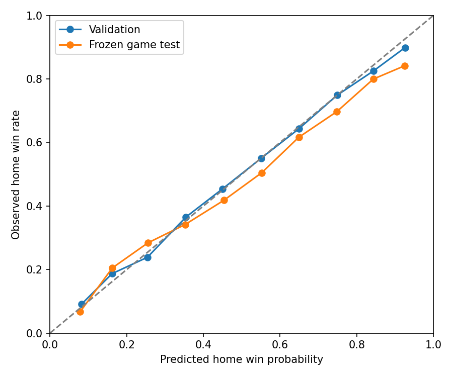

# Game-Log Calibration for V1 Single-Game Simulation

Research only. No production API/UI, playoffs, gamecast, season simulator, or team-model retraining.

## Reproduction and Provenance

`python scripts/simulation/acquire_game_logs.py` downloads only Games.csv, TeamStatistics.csv and TeamStatisticsExtended.csv. `--offline` verifies cached hashes without network. `python scripts/simulation/build_game_logs.py` rebuilds canonical games offline. `python scripts/simulation/game_log_calibration.py --develop` fits TRAIN and selects on validation; tests then `--final` once. `--report` only renders saved results. The exclusive ledger blocks further final evaluation or development.

Source: [https://www.kaggle.com/datasets/eoinamoore/historical-nba-data-and-player-box-scores](https://www.kaggle.com/datasets/eoinamoore/historical-nba-data-and-player-box-scores/versions/515), Eoin A Moore, NBA.com upstream per author. Version 515; CC0: Public Domain; updated 2026-06-15T11:08:10.51Z. Anonymous public Kaggle file endpoints, no token/login, HTML scraping, or restriction bypass. Cold pipeline requests: 4; warm/offline:0. Exact URLs/bytes/SHA256 in `data/simulation/game_log_source_manifest.json`. Raw downloads and large canonical/prediction CSVs ignored.

Coverage: 1979-80 through 2024-25, 51609 canonical regular-season games. Quarantined invalid records: 4; nonmatching canonical team-season schedule counts: 15. 2025-26 excluded prospectively because the pinned June snapshot is not assumed complete. Cup games count only when the official ID is002; finals/exhibitions/playoffs excluded. Full per-season counts and missingness in `game_log_quality.json`.

## Canonical Schema and Identity

`game_id, season, season_end_year, date, season_type, source_version, neutral_site, neutral_provenance, home_team_id, home_franchise_id, home_source_team_id, home_points, home_regulation_points, home_minutes, home_possessions, home_possession_method, away_team_id, away_franchise_id, away_source_team_id, away_points, away_regulation_points, away_minutes, away_possessions, away_possession_method, overtime_periods, overtime, possessions, pace, margin, home_win, regulation_margin, regulation_total, eligible, split, home_game_ortg, away_game_ortg, league_ortg, league_pace, league_prior_season_end_year, home_ortg, home_drtg, home_pace, home_prior_games, home_last_information_date, away_ortg, away_drtg, away_pace, away_prior_games, away_last_information_date`

Game IDs are source NBA IDs padded to10 digits, not synthesized IDs. Team/franchise IDs use the EXISTING historical identity functions, including separate Charlotte lineages, Nets, Seattle/OKC, Kings, Clippers and displaced Hornets. Game-index home/away IDs define joins; inconsistent box-row home flags are not trusted. Scores checked against corresponding team boxes; duplicate keys fail.

Actual possessions: mean of reported team possessions where present; else mean(FGA+0.44*FTA-ORB+TO). These fallback values are ESTIMATES, not reconstructed official counts. Source method is retained per side. Pace=possessions*48/game_minutes. Game minutes=numMinutes/5. Regulation points=sum(Q1..Q4), or final score only for confirmed48-minute games. Unknown/invalid periods remain missing/ineligible. OT possessions allocated by elapsed time, an explicit approximation. Outcome game ORtg columns are NEVER features; pregame home/away ORtg/DRtg/pace are separate fields. Missingness can restrict eligibility rather than fabricate historical fields.

## Leakage and Time Splits

`{"train": "1982-83 through2013-14 usable pregame strengths; prior years are source/warmup only", "validation": "2014-15 through2018-19", "test": "2019-20 through2024-25"}`

Pregame strength is regulation points per100 estimated regulation possessions, and pace. Each date's games are predicted BEFORE any results on that date update the accumulators. Fixed20-game previous-season franchise prior; expansion teams use prior league context. League environment uses only prior dates and a500-team-game prior-season prior. Every latest-information date is strictly earlier than game date. No full target-season team ratings, realized game pace, outcome, postgame Elo, or future roster outcomes enter model features. Actual pace is a TRAIN label/denominator for efficiency calibration only, never substituted for predicted pace at inference.

Counts: `{"train": 35514, "validation": 6149, "oof": 32713}`. Six expanding OOF blocks estimate variance from genuine earlier-fit predictions, not fitted residuals. OOF warmup through1984-85. Point model refit on all TRAIN only. Calibration candidates fixed before the final game test. Previously recorded TEAM-model test is protected by hashes and not rerun; the new GAME test evaluates a different locked research layer.

| candidate | train_end | evaluate_start | evaluate_end | n | pace_residual_sd | home_efficiency_residual_sd | away_efficiency_residual_sd |
| --- | --- | --- | --- | --- | --- | --- | --- |
| A_formula | 1985 | 1986 | 1990 | 4944 | 5.65799 | 9.44466 | 9.32654 |
| A_formula | 1990 | 1991 | 1995 | 5533 | 5.35929 | 9.71961 | 9.81340 |
| A_formula | 1995 | 1996 | 2000 | 5477 | 4.82991 | 10.43007 | 10.46208 |
| A_formula | 2000 | 2001 | 2005 | 5933 | 4.27818 | 10.44874 | 10.46389 |
| A_formula | 2005 | 2006 | 2010 | 6149 | 4.41017 | 10.58411 | 10.60099 |
| A_formula | 2010 | 2011 | 2014 | 4677 | 4.21965 | 10.31497 | 10.58944 |
| B_ridge30 | 1985 | 1986 | 1990 | 4944 | 5.41402 | 9.44481 | 9.29964 |
| B_ridge30 | 1990 | 1991 | 1995 | 5533 | 5.07777 | 9.72543 | 9.75997 |
| B_ridge30 | 1995 | 1996 | 2000 | 5477 | 4.63073 | 10.41800 | 10.43226 |
| B_ridge30 | 2000 | 2001 | 2005 | 5933 | 4.07407 | 10.42315 | 10.44468 |
| B_ridge30 | 2005 | 2006 | 2010 | 6149 | 4.04532 | 10.57953 | 10.56745 |
| B_ridge30 | 2010 | 2011 | 2014 | 4677 | 4.00875 | 10.28684 | 10.56043 |

## Home-Court and Variance Findings

TRAIN empirical blocks (final-score SD; adjusted effects use observed regulation pace for descriptive residual analysis, not prediction; effects are associations, not causal travel/home isolation):

| block | start | end | n | home_margin | home_win_rate | home_offensive_effect | home_defensive_effect | team_score_sd | total_sd | margin_sd | pace_sd | home_residual_sd | away_residual_sd |
| --- | --- | --- | --- | --- | --- | --- | --- | --- | --- | --- | --- | --- | --- |
| 0 | 1982-83 | 1988-89 | 6651 | 4.77086 | 0.65915 | 2.93633 | 1.85651 | 12.49117 | 21.03909 | 12.59985 | 7.32536 | 9.61353 | 9.79633 |
| 1 | 1989-90 | 1998-99 | 10915 | 3.74915 | 0.61438 | 2.15934 | 1.62446 | 13.11904 | 22.34078 | 13.24012 | 7.04715 | 9.58892 | 9.64388 |
| 2 | 1999-00 | 2008-09 | 12042 | 3.34969 | 0.60513 | 2.38833 | 0.97264 | 12.23354 | 20.59796 | 12.77362 | 5.21061 | 9.68412 | 9.72355 |
| 3 | 2009-10 | 2013-14 | 5906 | 2.91229 | 0.59583 | 1.76599 | 1.14971 | 11.92780 | 19.69502 | 13.14385 | 4.95594 | 9.69622 | 9.85319 |

Validation empirical blocks:

| block | start | end | n | home_margin | home_win_rate | home_offensive_effect | home_defensive_effect | team_score_sd | total_sd | margin_sd | pace_sd | home_residual_sd | away_residual_sd |
| --- | --- | --- | --- | --- | --- | --- | --- | --- | --- | --- | --- | --- | --- |
| 3 | 2014-15 | 2018-19 | 6149 | 2.61083 | 0.58367 | 2.00000 | 0.60173 | 12.64898 | 21.09635 | 13.71732 | 5.15987 | 10.15233 | 10.42738 |

Home effect is learned as a signed half-effect for each side, by broad TRAIN era, not hardcoded+3. The2010+ coefficients are estimated through2013-14 ONLY; no later home effect is silently refit. Era covariance is shrunk toward pooled OOF covariance using500 pseudo-games. Unseen recent years reuse the latest TRAIN block; validation chooses pooled versus era variance, not individual test-season coefficients.

## Expected Score and Candidates

A: efficiency=league+own_offense_above_league+opponent_defense_above_league+TRAIN common offset+signed home effect. Pace=mean(team paces). B: ridge30 learns the two efficiency weights, common offset, four signed home effects and a pace-deviation slope. Both predict efficiency before multiplying by expected possessions/100; they do NOT blindly average ORtg and opponent DRtg. No nonlinear family justified: retain the small4-candidate mean/variance comparison.

| candidate | efficiency_intercept | own_offense | opponent_defense | home_minus_away_effect_per100_by_era | pace | era_blocks |
| --- | --- | --- | --- | --- | --- | --- |
| A_formula | 0.53805 | 1.00000 | 1.00000 | [4.600443093740983, 3.8521218195987648, 3.596925309342134, 3.088818087576278] | {"slope": 1.0, "intercept": 0.0} | ["through1989", "1990-1999", "2000-2009", "2010 onward; TRAIN fit through2014 only"] |
| B_ridge30 | 0.54691 | 0.84015 | 0.81725 | [4.585062970764068, 3.837317267171403, 3.5866875482834906, 3.0791798080995227] | {"slope": 1.9119037248238502, "intercept": -0.29955959021065387} | ["through1989", "1990-1999", "2000-2009", "2010 onward; TRAIN fit through2014 only"] |

| candidate | n | score_mae | margin_mae | total_mae | margin_bias | brier | log_loss | accuracy | ece | margin_coverage80 | margin_coverage95 |
| --- | --- | --- | --- | --- | --- | --- | --- | --- | --- | --- | --- |
| A_formula_pooled | 6149 | 8.96554 | 9.81527 | 14.77242 | 0.35248 | 0.21019 | 0.60778 | 0.66612 | 0.00693 | 0.79525 | 0.93430 |
| A_formula_era | 6149 | 8.96590 | 9.81529 | 14.77238 | 0.35231 | 0.21016 | 0.60768 | 0.66612 | 0.00567 | 0.80875 | 0.94162 |
| B_ridge30_pooled | 6149 | 8.88682 | 9.79752 | 14.54171 | 0.34131 | 0.21067 | 0.60897 | 0.66466 | 0.01724 | 0.78988 | 0.93316 |
| B_ridge30_era | 6149 | 8.88794 | 9.79756 | 14.54353 | 0.34104 | 0.21086 | 0.60948 | 0.66466 | 0.02220 | 0.80566 | 0.94210 |

Selected `A_formula_pooled`. Selection: lowest validation log loss among candidates within0.5 best margin MAE; prefer simpler within0.002 log loss and0.2 score MAE. All actual coefficients/variance arrays are in the summary and ignored artifact.

## Win Probability and Monte Carlo

Draw jointly Gaussian residuals for pace, home efficiency, away efficiency using genuine TRAIN-OOF covariance. This retains shared pace and score correlation; independent score noise is not assumed. Compute score as (mean_pace+pace_noise)*(mean_efficiency+efficiency_noise)/100 minus the covariance-product mean term. Round to nonnegative integer scores. Analytic margin variance includes the Gaussian product's second-order covariance. Analytic probability combines Gaussian regulation win mass, the fitted close-game tie atom and a Gaussian OT-margin approximation; analytic final means approximate expected overtime additions. Monte Carlo explicitly resolves ties; analytic and MC probabilities are evaluated separately, not fitted to test outcomes.

Default10000 draws: worst-case win-rate MC standard error0.5 percentage points. Practical minimum1000:1.58 points, not the default. Seed is explicit, local numpy Generator; game-test seed=20261015+NBA game ID. Same input/seed exactly reproducible. Counts benchmarked, not assumed:

| count | seconds_median | worst_case_win_probability_mc_se |
| --- | --- | --- |
| 1000 | 0.00134 | 0.01581 |
| 10000 | 0.00161 | 0.00500 |
| 50000 | 0.00559 | 0.00224 |

Tied rounded regulation scores get explicit five-minute overtime scoring increments. Joint paired OT residuals are bootstrapped from genuine TRAIN-OOF games with exactly one observed OT, centered before adding expected5/48 regulation scoring. TRAIN-OOF diagnostics showed Gaussian rounding underestimates regulation ties. One empirical Bernoulli parameter moves a fraction of1-3 point rounded margins onto a tie, approximately preserving total score; it is not uniform scoring noise or an extra strength adjustment. This simple endgame atom changes near-zero regulation margins slightly and is an explicit modeling approximation. Repeat OT until untied; after20 periods fail loudly, never silently return a tie or resolve with a coin flip. This is not a possession engine.

Selected TRAIN-only overtime fit: `{"fitting_games": 1649, "repeat_probability": 0.14337662337662338, "observed_game_ot_rate": 0.05884510744963776, "tie_calibration": {"extra_tie_probability": 0.17622517169298976, "gaussian_tie_rate": 0.028781176872156575, "observed_tie_rate": 0.05884510744963776, "fitting_rows": 32713, "definition": "One fitted Bernoulli tie atom for rounded1-3 point margins; TRAIN only"}}`

## Existing Engine and Uncertainty

Frozen existing ORtg/pace artifacts and approved DRtg(identity gamma1) were loaded for an inference-only2014-15 through2018-19 bridge. No defensive tuning. Results below are diagnostic, not fully prospective: retrospectively known full-season roster membership does not establish what a pregame roster would have been. Primary probability/variance results use strictly prior-date box-score strengths.

`{"n": 6149, "metrics": {"n": 6149, "score_mae": 9.42808636561802, "margin_mae": 10.079262971588047, "total_mae": 15.795235900896651, "margin_bias": 0.37123771975909586, "brier": 0.2188719248006509, "log_loss": 0.6276988277932154, "accuracy": 0.6477476012359733, "ece": 0.011645997883237405, "margin_coverage80": 0.7754106358757522, "margin_coverage95": 0.9273052528866482, "calibration_bins": [{"low": 0.1, "n": 29, "predicted": 0.17042466436118592, "actual": 0.10344827586206896}, {"low": 0.2, "n": 146, "predicted": 0.26156697036700144, "actual": 0.2876712328767123}, {"low": 0.3, "n": 482, "predicted": 0.358881960130369, "actual": 0.2883817427385892}, {"low": 0.4, "n": 955, "predicted": 0.45433718113945876, "actual": 0.44502617801047123}, {"low": 0.5, "n": 1480, "predicted": 0.5515067043131843, "actual": 0.5466216216216216}, {"low": 0.6, "n": 1541, "predicted": 0.6494903853492449, "actual": 0.6463335496430889}, {"low": 0.7, "n": 1093, "predicted": 0.7462870829340257, "actual": 0.7520585544373285}, {"low": 0.8, "n": 383, "predicted": 0.8377001982206902, "actual": 0.8276762402088773}, {"low": 0.9, "n": 40, "predicted": 0.9185647535445074, "actual": 0.9}]}, "identity_gamma": 1.0, "team_model_retrained": false, "prospective": false, "warning": "Retrospective season membership; uncertainty/variance trained on different pregame-strength estimator; diagnostic only"}`

Keep point means unchanged. HIGH is an explicit unsupported-domain warning, not a calibrated probability interval. No arbitrary variance multiplier.

Statistical game-outcome intervals do not quantify unknown synthetic-roster interactions. Keep HIGH flags, warn and restrict claims; do not arbitrarily shift means or apply an unvalidated2x variance. Numerical epistemic propagation remains a targeted requirement for a prospective engine bridge, not hidden behind attractive winner accuracy.

## Limitations

- Game calibration primarily validated with prior-date box-score strength estimates, not timestamped player rotations
- Frozen team-engine bridge uses retrospectively known season membership; not a fully prospective roster test
- 2010-14 learned home effect and latest training-era covariance extrapolated to newer eras without refitting
- Only identified Orlando neutral games excluded; other neutral sites may remain
- Possession estimator changes around1996-97; early box scores have missingness
- 1979-80/1980-81 and much of1981-82 have zero-coded unavailable FGA; retained scores cannot supply valid possessions
- Pinned source has five missing2024-25 games plus four invalid tied/zero-score records quarantined across all years
- Gaussian latent residuals approximate tails; overtime bootstrap is not possession-by-possession

## Final Game Test and Decision

Thresholds fixed before test: score MAE<=11; margin MAE<=13.5; total MAE<=17.5; Brier<=.23; log loss<=.66; ECE<=.04; regulation-margin80% coverage in[.75,.85],95% coverage in[.92,.98]; each season absolute margin bias<=3 and ECE<=.07. A additionally requires a fully prospective existing-engine bridge. These are research criteria, not the old defensive gates.

| method | n | score_mae | margin_mae | total_mae | margin_bias | brier | log_loss | accuracy | ece | margin_coverage80 | margin_coverage95 |
| --- | --- | --- | --- | --- | --- | --- | --- | --- | --- | --- | --- |
| analytic | 6906 | 9.38052 | 10.98617 | 15.02747 | 1.16908 | 0.22184 | 0.63479 | 0.64263 | 0.03894 | 0.75630 | 0.91312 |
| MC10000 | 6906 | 9.37916 | 10.98864 | 15.02574 | 1.16605 | 0.22183 | 0.63477 | 0.64133 | 0.03688 | 0.75630 | 0.91312 |

| season | n | score_mae | margin_mae | total_mae | margin_bias | brier | log_loss | accuracy | ece | margin_coverage80 | margin_coverage95 |
| --- | --- | --- | --- | --- | --- | --- | --- | --- | --- | --- | --- |
| 2020 | 971 | 9.19240 | 10.24045 | 15.24531 | 0.72575 | 0.21631 | 0.62082 | 0.66941 | 0.04207 | 0.79506 | 0.93409 |
| 2021 | 1080 | 9.51092 | 11.48606 | 15.01921 | 2.12711 | 0.23524 | 0.66456 | 0.60185 | 0.06267 | 0.73981 | 0.91481 |
| 2022 | 1172 | 9.48963 | 11.56232 | 14.93610 | 1.34885 | 0.22266 | 0.63967 | 0.64164 | 0.04442 | 0.73208 | 0.89420 |
| 2023 | 1230 | 9.11609 | 10.25861 | 14.79879 | 0.54866 | 0.22774 | 0.64879 | 0.63496 | 0.03133 | 0.79350 | 0.92846 |
| 2024 | 1230 | 9.55298 | 11.12579 | 15.26302 | 0.85683 | 0.21457 | 0.61643 | 0.64715 | 0.04586 | 0.74309 | 0.90732 |
| 2025 | 1223 | 9.40267 | 11.17601 | 14.94245 | 1.44078 | 0.21496 | 0.61930 | 0.66149 | 0.04744 | 0.73917 | 0.90352 |

| group | n | score_mae | margin_mae | total_mae | margin_bias | brier | log_loss | accuracy | ece | margin_coverage80 | margin_coverage95 |
| --- | --- | --- | --- | --- | --- | --- | --- | --- | --- | --- | --- |
| even_abs_expected_margin_le3 | 2181 | 9.38492 | 11.13299 | 15.07138 | 1.43629 | 0.24938 | 0.69192 | 0.53599 | 0.04401 | 0.76341 | 0.91609 |
| home_underdogs | 2169 | 9.44777 | 10.99902 | 15.20069 | 0.45378 | 0.22483 | 0.64082 | 0.64454 | 0.02641 | 0.74919 | 0.91471 |
| strong_mismatch_abs_expected_margin_ge10 | 1148 | 9.28206 | 10.89410 | 14.97814 | 1.54803 | 0.15850 | 0.49982 | 0.80488 | 0.04811 | 0.74913 | 0.91028 |
| high_pace_ge100 | 2976 | 9.57947 | 11.11960 | 15.38448 | 1.10689 | 0.22143 | 0.63307 | 0.64046 | 0.03825 | 0.75638 | 0.91767 |

Elite/poor matchup proxy is abs(expected margin)>=10; it is not defined using final standings/outcomes.

| block | start | end | n | home_margin | home_win_rate | home_offensive_effect | home_defensive_effect | team_score_sd | total_sd | margin_sd | pace_sd | home_residual_sd | away_residual_sd |
| --- | --- | --- | --- | --- | --- | --- | --- | --- | --- | --- | --- | --- | --- |
| 3 | 2019-20 | 2024-25 | 6906 | 1.87127 | 0.55184 | 1.70005 | 0.19232 | 12.59474 | 20.08521 | 15.08768 | 4.62603 | 10.95967 | 11.01176 |

Observed test OT rate=0.04561; MC rate=0.05742. Entire test MC time=27.15s. No retuning.

| low | n | predicted | actual |
| --- | --- | --- | --- |
| 0.00000 | 15 | 0.07823 | 0.06667 |
| 0.10000 | 117 | 0.16253 | 0.20513 |
| 0.20000 | 384 | 0.25513 | 0.28385 |
| 0.30000 | 708 | 0.35251 | 0.34181 |
| 0.40000 | 945 | 0.45347 | 0.41799 |
| 0.50000 | 1313 | 0.55235 | 0.50495 |
| 0.60000 | 1387 | 0.64890 | 0.61644 |
| 0.70000 | 1120 | 0.74828 | 0.69732 |
| 0.80000 | 734 | 0.84335 | 0.79973 |
| 0.90000 | 183 | 0.92488 | 0.84153 |

Representative games chosen by predicted matchup context, not whether the prediction was correct:

| example | game_id | date | season | home_team_id | away_team_id | home_points | away_points | home_win_probability | analytic_probability | ot_rate | mean_home_points | mean_away_points | margin_interval80 | mean_possessions | count | seed | uncertainty | warning |
| --- | --- | --- | --- | --- | --- | --- | --- | --- | --- | --- | --- | --- | --- | --- | --- | --- | --- | --- |
| close | 0022100809 | 2022-02-06 | 2021-22 | team:los-angeles-clippers | team:milwaukee-bucks | 113 | 137 | 0.49970 | 0.49996 | 0.06260 | 110.66780 | 110.66450 | [-16.0, 16.0] | 99.83375 | 10000 | 42361824 | STANDARD | None |
| strong_favorite | 0022400400 | 2024-12-23 | 2024-25 | team:oklahoma-city-thunder | team:washington-wizards | 123 | 105 | 0.97970 | 0.97740 | 0.00940 | 126.10380 | 100.86700 | [9.0, 41.0] | 101.85942 | 10000 | 42661415 | STANDARD | None |
| high_scoring | 0022300480 | 2024-01-05 | 2023-24 | team:indiana-pacers | team:atlanta-hawks | 150 | 116 | 0.61960 | 0.61178 | 0.06210 | 128.89280 | 125.13330 | [-12.0, 20.0] | 102.48413 | 10000 | 42561495 | STANDARD | None |
| low_scoring | 0021900007 | 2019-10-23 | 2019-20 | team:miami-heat | team:memphis-grizzlies | 120 | 101 | 0.67290 | 0.67485 | 0.06430 | 105.95310 | 100.40020 | [-10.0, 21.0] | 97.97859 | 10000 | 42161022 | STANDARD | None |

Acceptance: `{"score_mae": true, "margin_mae": true, "total_mae": true, "brier": true, "log_loss": true, "calibration": true, "coverage80": true, "coverage95": false, "monte_carlo_metrics": false, "season_stability": true, "prospective_existing_engine_bridge": false}`

**B. GAME-LEVEL CALIBRATION NEEDS TARGETED FIX**

Existing engine bridge is not fully prospective; the game layer's numerical uncertainty is not automatically validated for highly extrapolated synthetic rosters. A targeted integration/calibration fix, not further defensive tuning, is required.

Validate a timestamped pregame roster/strength bridge and its residual variance; resolve any failed era gates before production. No defensive retuning or UI yet.

Original team research and historical inputs unchanged by hash. Final GAME test consumed once; old TEAM test not reevaluated. No production API/UI changes, no merge or push.

## Final Interpretation

The failed 95% regulation-margin coverage gate is substantive: 91.31% observed coverage versus the predeclared acceptable range of 92-98%, and versus the nominal 95% target. The coverage columns in both metric rows refer to the same analytic regulation-margin intervals; they are not a separate validation of sampled final-score intervals. Monte Carlo point and probability metrics do use the sampled final outcomes.

The held-out home point margin is 1.87 versus 2.91 in the latest training block; the model's test margin bias is +1.17. Final-score margin SD rises from 13.14 in that training block to 15.09 in the game test. These are descriptive distribution shifts, not a causal attribution. The simulated overtime rate is 5.74% versus 4.56% observed, despite the training-only tie correction matching the older TRAIN tie frequency. Thus neither a plausible winner accuracy nor a reasonable aggregate Brier score establishes stable modern-era tail and overtime calibration.

Next: define a separate modern-era variance, home-court and endgame calibration protocol with a NEW untouched holdout, and validate a timestamped pregame roster/strength bridge. The already consumed 2019-20 through 2024-25 game test must not become another repeatedly tuned acceptance benchmark. Keep the approved defensive team model fixed. No production Simulator API/UI is authorized by this result.

Verification: 46 simulation tests passed, including 13 new game-calibration tests. Historical dataset validation, historical API tests, Team Builder tests and both JavaScript syntax checks passed. The .NET solution build succeeded with zero warnings and zero errors. The win-probability figure was visually inspected. Cached-source verification made zero network requests. All 39 protected historical/research/artifact hashes remained unchanged.
